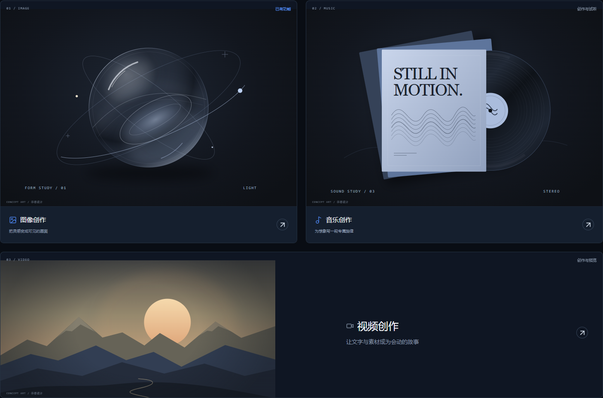
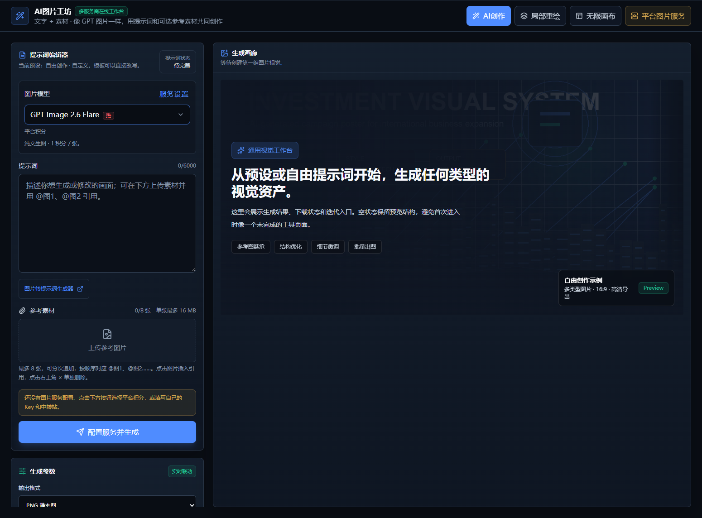
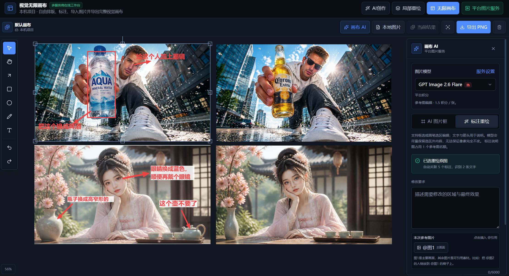
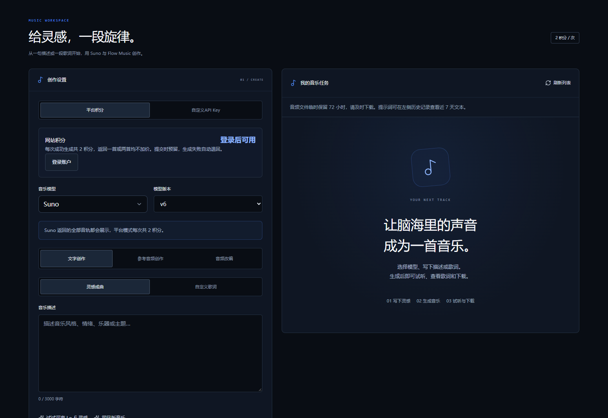
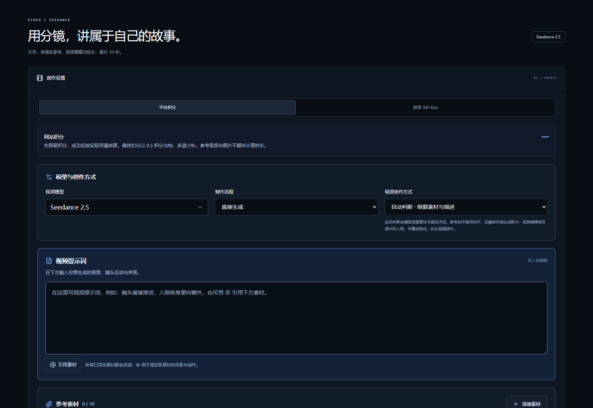
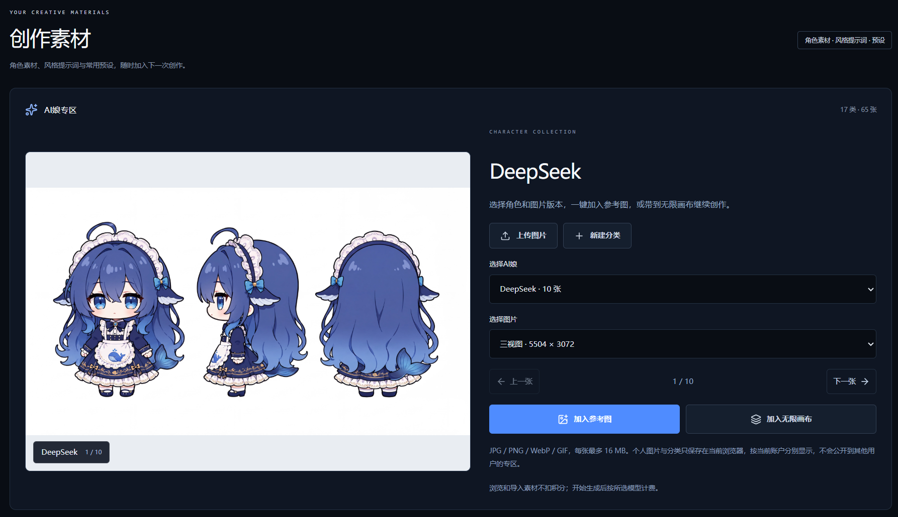
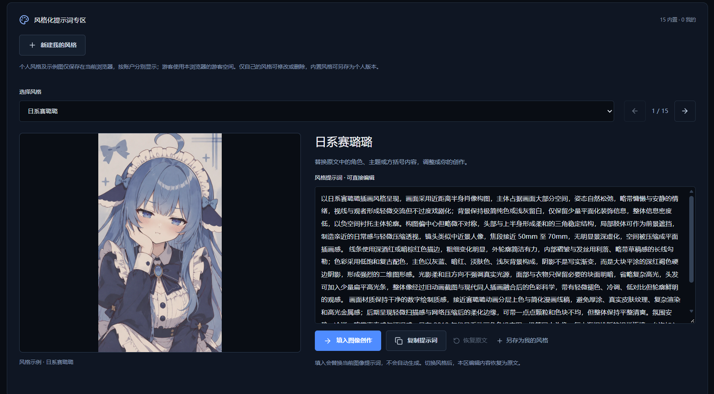

<div align="center">

# PosterFlow AI

### AI 全功能生成工作台

**图像、音乐、视频，在同一个工作台创作。**

从一句描述到一张海报、一段旋律、一组视频镜头，<br>
用参考素材、局部重绘和无限画布，把想法继续做下去。

[立即体验](https://www.posterflow-ai.xyz/) · [功能介绍](#从灵感到作品) · [快速上手](#开始你的第一次创作) · [反馈建议](https://github.com/Something11235/PosterFlow-AI/issues)

</div>



*图 1 · 一个工作台，选择图像、音乐或视频，开始新的创作。*

## 从灵感到作品

PosterFlow AI 面向想做图、写歌、制作视频素材的创作者。打开浏览器，就能在中文界面里选择模型、添加参考素材、生成并下载结果；需要细改图片时，继续进入局部重绘或无限画布。

你可以为一支短视频分别制作封面、背景音乐和视频镜头，也可以只用它画一个角色、整理一套海报方案，或把写好的歌词变成歌曲。

| 想做什么 | 在 PosterFlow AI 中怎么做 |
| --- | --- |
| 做海报、封面、产品图、角色设定 | 文字生图、多图参考、批量生成，再继续修改 |
| 修改画面的一部分 | 通过参考图、文字说明或画布选区，指定修改内容 |
| 比较构图、整理视觉方案 | 把图片和标注放进无限画布，排布、修改并导出 |
| 给视频配乐、把歌词写成歌 | 描述曲风与情绪，或填写歌词，生成后试听和下载 |
| 制作视频镜头 | 从文字、图片或其他参考素材开始，按模型选择首尾帧、编辑或延长 |
| 复用角色和喜欢的画风 | 从角色素材、风格提示词与个人预设中取用，继续创作 |

### 图像创作：生成之后，还能继续改

在同一个页面完成描述、参考图上传、生成、预览和下载。支持多图参考，可用 `@图1`、`@图2` 说明不同素材的用途；结果可以继续重绘，或带入画布排版。

- **多模型切换**：GPT Image、Nano Banana、Grok、即梦 Seedream，按任务选择。
- **批量比较方案**：支持批量的模型可选择生成数量；GPT Image 2.6 可选 1–4 张，默认 1 张。
- **参考与细节修改**：保留原图作为输入，描述需要调整的角色、背景、构图或细节。
- **动图结果保留**：服务返回 GIF 时保留动画，支持播放与原文件下载；实际生成能力以所选服务为准。



*图 2 · 模型、提示词、参考素材与结果画廊放在同一工作区。*

### 无限画布：把参考、构图和修改说明放到一起

将本地图片或生成结果放到画布上，拖动、缩放、比较方案，再用箭头、文字或选区说明想改哪里。支持画布 AI 图片框生成，以及适配模型的选区编辑。

- 导入图片，搭配箭头、文字、矩形、圆形和画笔工具。
- 使用矩形、圆形或画笔选区进行局部修改；GPT Image 2.6 支持透明蒙版重绘。
- 从素材区直接加入角色图片，或将当前生成结果带入画布。
- 支持撤销、重做、视图适配与 PNG 导出；画布自动保存在当前浏览器。



*图 3 · 把修改要求标在原图上，在同一画布中对照编辑结果。*

不同模型的参考图、选区和动图能力不同，工作台会按模型显示可用功能。个人画布保存在本机浏览器，不自动跨设备同步。

### 音乐创作：从一句描述或一段歌词开始

选择 Suno 或 Flow Music，写下曲风、情绪、乐器或歌词。生成任务、音轨、歌词和下载入口集中展示，可以在网页中直接试听。

- 提供灵感成曲、自定义歌词和纯音乐等创作方式。
- 支持模型对应的参考音频创作与音频改编。
- Suno 返回的多首音轨会一并展示，方便试听比较。
- 平台积分模式每次成功共 **2 积分**，返回两首也不加价。



*图 4 · 选择音乐模型，填写灵感或歌词，生成后在右侧试听与下载。*

### 视频创作：让文字与素材成为镜头

默认使用 Seedance 2.5，也可以切换其他已接入模型。根据模型能力，使用文字、图片、音频、参考视频或首尾帧进行创作；支持对应模型的视频编辑、延长与样片流程。

- **多种创作方式**：文字成片、参考素材创作，以及支持模型的首尾帧、视频编辑和延长。
- **自动判断入口**：结合素材和描述辅助选择创作方式，也可以手动指定。
- **任务进度可查**：查看受理、生成和结算状态，完成后预览、下载视频。
- **费用提前说明**：提交前查看预计费用与预留说明，按模型规则结算。



*图 5 · 从模型、创作方式和提示词开始，按任务添加所需参考素材。*

### 创作素材：常用角色与画风，下次直接用

**AI 娘专区**提供角色参考图片，可以一键加入生图参考或无限画布。你也能上传自己的图片、创建个人分类，并管理自己的素材。



*图 6 · 选择角色和图片版本，一键加入参考图或无限画布。*

**风格化提示词专区**收录可直接编辑的风格文本与示例图。选中喜欢的画风，调整内容后填入图像创作；也可以新建个人风格，或把内置风格另存为自己的版本。个人项支持修改、删除，内置内容保留。



*图 7 · 看示例、调整提示词，再填入创作；常用风格可以另存复用。*

个人角色素材、分类与风格保存在当前浏览器，并按账户分开显示，不会公开到其他用户的素材区，也不自动同步到其他设备。

## 多种模型，一个熟悉的工作台

| 创作类型 | 已接入的模型系列 |
| --- | --- |
| 图像 | GPT Image 2.6 Flare / Sunburst、GPT Image 2.5 Flare / Sunburst、Nano Banana 2.1、Grok Imagine Image 2.0 / Ext、（即梦）Seedream 5.0 Pro / Lite / Flash |
| 音乐 | Suno、Flow Music |
| 视频 | Seedance 2.5、Seedance 2.0 / Fast / Mini、Gemini Omni 1.1 Flash、MiniMax H3 / H3 Max、Wan 3.0、FLUX 3 Video |

模型的分辨率、批量数量、素材类型和编辑能力各不相同，具体以网站「模型一览」及创作表单为准。

## 开始你的第一次创作

1. 打开 **[posterflow-ai.xyz](https://www.posterflow-ai.xyz/)**，注册并完成邮箱验证。
2. 选择「图像创作」「音乐创作」或「视频创作」。
3. 选择模型，输入描述；需要时添加图片、音频或视频参考。
4. 查看费用说明后提交，在任务区查看进度。
5. 预览、下载结果，或复用提示词、继续修改图片。

图片创作也可以先从「创作素材」选择角色或风格，再补充自己的想法。

### 平台积分与自带 API Key

| 使用方式 | 适合谁 | 计费方式 |
| --- | --- | --- |
| 平台积分 | 希望选好模型就开始创作的用户 | 按模型页面显示的积分规则计费 |
| 自带 API Key | 已有兼容服务接口，希望自行管理用量的用户 | 不扣网站积分，上游服务费用由自己的账户承担 |

GPT Image 2.6 的平台价格为无图片输入 **1 积分 / 张**、有图片输入 **1.5 积分 / 张**，局部重绘和画布编辑原图属于图片输入。其他模型、音乐和视频的价格请查看相应表单。

平台模式提交时预留积分，成功后按对应规则结算，明确失败退回预留。提交结果暂时未知时，保留原任务查询核对，避免重复提交。生成内容和下载链接有保留期限，请及时下载；可在历史记录中回看保留期内的提示词与创作设置。

## 数据与隐私

- 平台服务密钥在服务端使用，不下发到浏览器。
- 自带 Key 由浏览器会话或页面内存暂存，随业务请求交给后端转发，不写入数据库、生成历史或云端图片存储。
- 账号生成记录与私有媒体受身份校验；个人素材、风格和画布采用前述本地保存方式。
- 不要把密钥、登录凭证或私人素材发布到公开 Issue。反馈时请提供已脱敏的错误提示与复现步骤。

## 开发与部署

项目使用 **React + Vite + Tailwind CSS** 构建界面，**Fabric.js** 提供画布编辑，后端为 **Flask**，账户、数据库与私有存储使用 **Supabase**，线上运行于 **Vercel**。

<details>
<summary><strong>本地运行与检查</strong></summary>

需要 Node.js 20.19+（或兼容的更新版本）、Python 3.11+，以及自行配置的开发服务。

在项目根目录运行：

```powershell
# 首次安装依赖
.\start-dev.bat --setup-only

# 按 .env.example 在本地创建 .env，并配置自己的开发服务
# 前端的 VITE_ 公开配置按 Vite 规则放在 frontend/.env.local
# 仅可填写可公开的 Supabase URL 与发布密钥，不能放服务端 Secret

# 启动后端 5001 与前端 3001
.\start-dev.bat

# 完整工作台的本地自带 Key 模式（无需正式账号或数据库）
# 后端 5001，前端 http://127.0.0.1:3002/
.\start-dev.bat --local-own-key
```

账号、积分和持久化生成功能需要配置自己的 Supabase 与上游服务；未配置时不具备真实生成能力。数据库迁移须先核对目标环境和已执行记录，再按依赖准备，避免重复应用。

`--local-own-key` 使用同一套完整工作台界面，隔离真实环境文件和 Supabase 配置，供手动填写 BuyToken Key 验收 GPT2.6。任务、参考素材和结果只保存到本机忽略目录 `artifacts/local-own-key/`；不扣网站积分，上游按实际调用计费。参考图、局部编辑和画布可通过实际上游验证，尚未实测的能力不作保证。该开发入口只允许本机访问，不作为正式部署入口。

```powershell
npm --prefix frontend test
npm --prefix frontend run lint
npm --prefix frontend run build
git diff --check
```

本地 `.env`、会话、私有媒体和部署凭据不提交到仓库。前端 `VITE_*` 会进入浏览器构建，只放可公开的配置。

</details>

## 反馈与交流

欢迎通过网站侧栏的「QQ 交流群」交流使用体验，也可以在 [GitHub Issues](https://github.com/Something11235/PosterFlow-AI/issues) 提交建议或问题。反馈时附上浏览器、创作类型、模型和脱敏后的错误信息，会更容易定位。

如果这个工作台帮你完成了作品，欢迎分享 [PosterFlow AI](https://www.posterflow-ai.xyz/)；也欢迎给仓库点一个 Star。

[更新记录](CHANGELOG.md) · [安全说明](SECURITY.md) · [界面规范](docs/UI_DESIGN_SPEC.md)
