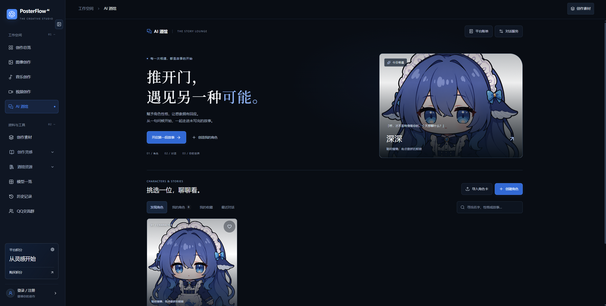

<div align="center">

# PosterFlow AI

### AI 全功能生成工作台

**图像、音乐、视频与 AI 酒馆，在同一个工作台创作。**

从一句描述到一张海报、一段旋律、一组视频镜头，或一段角色故事，<br>
用参考素材、无限画布与角色对话，把想法继续做下去。

[立即体验](https://www.posterflow-ai.xyz/) · [进入 AI 酒馆](https://www.posterflow-ai.xyz/?area=tavern) · [功能介绍](#从灵感到作品) · [快速上手](#开始你的第一次创作) · [反馈建议](https://github.com/Something11235/PosterFlow-AI/issues)

</div>


*图 1 · 从创作总览或主导航，进入图像、音乐、视频与 AI 酒馆。*

## 从灵感到作品

PosterFlow AI 面向想做图、写歌、制作视频素材与角色故事的创作者。打开浏览器，就能在中文界面里选择模型、添加参考素材、生成并下载结果；需要细改图片时，继续进入局部重绘或无限画布，也能在 AI 酒馆中与角色对话、整理剧情，再把故事带入图像创作。

你可以为一支短视频分别制作封面、背景音乐和视频镜头，也可以只用它画一个角色、整理一套海报方案，或把写好的歌词变成歌曲。

| 想做什么 | 在 PosterFlow AI 中怎么做 |
| --- | --- |
| 做海报、封面、产品图、角色设定 | 文字生图、多图参考、批量生成，再继续修改 |
| 修改画面的一部分 | 通过参考图、文字说明或画布选区，指定修改内容 |
| 比较构图、整理视觉方案 | 把图片和标注放进无限画布，排布、修改并导出 |
| 给视频配乐、把歌词写成歌 | 描述曲风与情绪，或填写歌词，生成后试听和下载 |
| 制作视频镜头 | 从文字、图片或其他参考素材开始，按模型选择首尾帧、编辑或延长 |
| 和角色聊天、续写故事 | 进入 AI 酒馆，选择或导入角色，设置人设、剧情记忆与世界书 |
| 复用角色和喜欢的画风 | 从角色素材、风格提示词与个人预设中取用，继续创作 |

### 图像创作：生成之后，还能继续改

在同一个页面完成描述、参考图上传、生成、预览和下载。支持多图参考，可用 `@图1`、`@图2` 说明不同素材的用途；结果可以继续重绘，或带入画布排版。

- **多模型切换**：GPT Image、Nano Banana、Grok、即梦 Seedream，按任务选择。
- **批量比较方案**：支持批量的模型可选择生成数量；GPT Image 2.6 可选 1–4 张，默认 1 张。
- **参考与细节修改**：保留原图作为输入，描述需要调整的角色、背景、构图或细节。
- **动图结果保留**：服务返回 GIF 时保留动画，支持播放与原文件下载；实际生成能力以所选服务为准。
- **生图任务找回**：侧栏或「历史记录 → 生图任务」查看近 7 天最多 50 笔任务；刷新后可同步本人平台任务，按原服务线路查询已有结果。已接单任务查询遇到暂时断网会有限重试，只读取原任务，不重新生图；已收到结果但尚未保存的任务也可继续查询保存。提交结果未知时保留预留积分，核实后处理。任务记录不代表永久保存原图，请及时下载。当前任务完成后自动更新画廊，旧的失败状态不会覆盖已完成结果。图片预览加载失败可重新读取已有图片；账户同步异常单独提示，不遮住生成结果。


*图 2 · 模型、提示词、参考素材与结果画廊放在同一工作区。*

### 无限画布：把参考、构图和修改说明放到一起

将本地图片或生成结果放到画布上，拖动、缩放、比较方案，再用箭头、文字或选区说明想改哪里。支持画布 AI 图片框生成，以及适配模型的选区编辑。

- 导入图片，搭配箭头、文字、矩形、圆形和画笔工具。
- 使用矩形、圆形或画笔选区进行局部修改；GPT Image 2.6 支持透明蒙版重绘。
- 从素材区直接加入角色图片，或将当前生成结果带入画布。
- 支持撤销、重做、视图适配与 PNG 导出；画布自动保存在当前浏览器。


*图 3 · 把修改要求标在原图上，在同一画布中对照编辑结果。*

不同模型的参考图、选区和动图能力不同，工作台会按模型显示可用功能。个人画布保存在本机浏览器，不自动跨设备同步。

### 音乐创作：从一句描述或一段歌词开始

选择 Suno 或 Flow Music，写下曲风、情绪、乐器或歌词。生成任务、音轨、歌词和下载入口集中展示，可以在网页中直接试听。

- 提供灵感成曲、自定义歌词和纯音乐等创作方式。
- 支持模型对应的参考音频创作与音频改编。
- Suno 返回的多首音轨会一并展示，方便试听比较。
- 平台积分模式每次成功共 **2 积分**，返回两首也不加价。


*图 4 · 选择音乐模型，填写灵感或歌词，生成后在右侧试听与下载。*

### 视频创作：让文字与素材成为镜头

默认使用 Seedance 2.5，也可以切换其他已接入模型。根据模型能力，使用文字、图片、音频、参考视频或首尾帧进行创作；支持对应模型的视频编辑、延长与样片流程。

- **多种创作方式**：文字成片、参考素材创作，以及支持模型的首尾帧、视频编辑和延长。
- **自动判断入口**：结合素材和描述辅助选择创作方式，也可以手动指定。
- **任务进度可查**：查看受理、生成和结算状态，完成后预览、下载视频。
- **费用提前说明**：提交前查看预计费用与预留说明，按模型规则结算。


*图 5 · 从模型、创作方式和提示词开始，按任务添加所需参考素材。*

### 创作素材：常用角色与画风，下次直接用

**AI 娘专区**提供角色参考图片，可以一键加入生图参考或无限画布。你也能上传自己的图片、创建个人分类，并管理自己的素材。


*图 6 · 选择角色和图片版本，一键加入参考图或无限画布。*

**风格化提示词专区**收录可直接编辑的风格文本与示例图。选中喜欢的画风，调整内容后填入图像创作；也可以新建个人风格，或把内置风格另存为自己的版本。个人项支持修改、删除，内置内容保留。


*图 7 · 看示例、调整提示词，再填入创作；常用风格可以另存复用。*

个人角色素材、分类与风格保存在当前浏览器，并按账户分开显示，不会公开到其他用户的素材区，也不自动同步到其他设备。

### AI 酒馆：和角色一起写下故事

从主导航的「AI 酒馆」或创作总览卡片进入，选择内置角色 **深深** 开始对话，也可以创建自己的角色，或导入已有角色卡。酒馆沿用工作台的深蓝界面，提供「发现角色」「我的角色」「我的收藏」与「最近对话」。



*图 8 · 正式站 AI 酒馆：选择深深、导入个人角色，或打开对话服务与平台账单。*

- **角色卡与世界书**：支持角色 JSON、含角色资料的 PNG，以及独立世界书 JSON；也可从含内嵌世界书的角色 PNG 提取设定。先读取预览，再确认导入。角色导入后进入「我的角色」，当前「发现角色」也会展示个人角色，内容不公开给其他用户。
- **文件与链接导入**：JSON 最大 1 MB，PNG 最大 8 MB。支持公开 HTTPS 下载直链和 Chub 角色／世界书详情页；需要登录的资源、主页与搜索列表不能直接导入。Chub 等外部站点可能限制托管服务器访问：详情页可打开，也可能远程导入失败，此时请下载 PNG／JSON 后使用「本地文件」。部分资源网站需要代理。
- **默认中文回复**：英文角色资料导入后，后续 AI 对话默认使用简体中文；原始设定与静态开场白保留原文，可自行编辑。角色卡支持 V2／V3 基础字段；高级世界书规则、脚本和插件不执行。PNG 原图可下载保留，本站 JSON 导出不保证携带全部第三方扩展。
- **可编辑的故事设定**：「我的人设」「剧情记忆」「世界书」及「故事的起点」均可修改。深深有初始预设，其他角色保留自己的资料；修改应用于当前对话，原聊天消息保留。
- **导出角色与世界书**：创建／编辑角色时可直接导出当前草稿；角色菜单和聊天顶部「导出设定」也提供 PNG 角色卡、JSON 角色卡、独立世界书 JSON。PNG 包含封面与 Character Card V2 资料，可重新导入本站或 SillyTavern；聊天中的导出包含当前故事起点与世界书，不包含用户人设、剧情记忆、聊天记录或 Key。原始第三方 PNG 仍可单独下载，和编辑后重新导出的卡片分别保留。
- **我的聊天头像**：在「世界与记忆 → 我的人设」上传、更换或移除自己的头像；用户消息同步显示。支持 2 MB 以内的 PNG／JPEG／WebP，缩小后按账户保存在本机，不上传给模型。
- **长对话整理**：新对话上下文默认 48,000 字符，支持直接输入 4,000–120,000 的整数字符预算，并提供 12,000／24,000／48,000／96,000 常用档位；已有对话保留原选择，单位不是 Token。可手动生成剧情摘要；自动整理默认关闭，开启后在容量达到约 80% 或未整理消息达到 32 条时调用模型，保留最近 12 条原文，摘要另计用量。摘要支持编辑与回退，原消息仍保留，不能保证记忆无遗漏。
- **故事管理与沉浸聊天**：故事记录支持重命名、删除和置顶，刷新后保留；删除有二次确认，手动名称不会被首条消息覆盖。顶部积分、用量与上下文默认收在「对话信息」中，回复费用默认折叠。
- **继续与改写**：选择备用开场、重新生成与切换回复版本，或编辑消息后创建独立分支；可复制回复、导出对话，并将剧情带入图像创作。
- **AI 助写**：输入框旁可根据当前故事，以用户第一人称生成中文草稿，或润色已输入的内容。结果只填入输入框，由你确认后发送；可恢复原草稿。助写按独立调用计费，失败时保留原输入。
- **中文图像提示词模板**：输入框旁「画面创作」提供角色全身、角色肖像、我的人设、双人同框、剧情场景、纯环境背景、最近画面和自由主题八类模板。可预览、编辑、保存到当前账户的本机酒馆，或恢复默认；支持角色、用户人设、场景、近期剧情等文字变量，不执行脚本或嵌套变量。消息下方「创作这幅画面」会选中对应消息，聊天外观中的模板入口可修改快捷背景模板。准备提示词不额外调用文字模型；前往生图后需确认模型、参数和价格，再点击生成。英文角色资料仍按原文节选作为参考，默认绘画指令使用中文。
- **个人背景库**：在「聊天外观」选择「按剧情生成背景」，自动带入故事起点、近期剧情和相关世界书，跳到生图页修改提示词、模型与参数；确认生成后按生图价格收费，成功图片自动存入酒馆背景库。画廊中的其他静态图片也可一键入库；入库失败可单独重试，无需再次生图。支持导入 12 MB 以内本地 PNG／JPEG／WebP、切换和删除，最多 20 张，压缩后与酒馆资料共用 20 MB 本机容量。旧单张背景自动保留到背景库。
- **沉浸外观**：可选夜海、星夜、暖灯预设或背景库图片；图片显示支持经典（左上铺满）、填充（居中铺满）、不变换（等比例完整显示）、拉伸、居中（按保存尺寸）五种方式，旧设置保持原来的居中铺满。文字托底支持液态玻璃、不透明和无底色，并可调节背景压暗。酒馆移除顶部工作空间横栏，为聊天留出空间。头像、背景和外观按账户保存在当前浏览器，不发送给对话模型，也不自动跨设备同步。
- **管理员运营**：「创作运营概览」的视频后新增 AI 酒馆页签，累计全部历史的总调用、使用用户、角色对话、剧情摘要、AI 助写和实际消耗积分，无日期筛选。异常账单仅在有待处理记录或读取异常时显示；自带 API 调用不进入平台统计，管理员看不到聊天正文。
- **剧情 BGM**：按当前场景、剧情记忆与最近四条消息准备中文纯音乐描述，可选六种氛围并编辑。确认后沿用音乐服务提交一次生成，平台每次 2 积分，自带音乐 Key 不扣平台积分；准备描述不额外计费。完成后选择“用于酒馆 BGM”返回对应故事，支持循环播放与音量调节，离开酒馆自动暂停。播放器在当前页面内保留，刷新后可从音乐任务重新选用；音频链接为临时资源，请及时下载。

在「对话服务」选择平台积分或自带兼容 API Key。服务设置显示「平台积分服务」；自带 API 的接口、Key 和模型输入框默认为空，仅提供灰色示例。回复的「Token 与费用」可展开查看服务商实际返回的 Token，用量缺失时显示未确认，不用文字长度冒充实际消耗。平台账单可查询预留、实扣、退款与待核对状态。

| 酒馆用量类型 | 积分 / 百万 Token |
| --- | ---: |
| 未缓存输入 | 6 |
| 输出 | 24 |
| 缓存读取（已含在输入内） | 0.12 |

按实际输入、输出自动结算；服务商不提供缓存明细时按普通输入价收费，只有明确的缓存用量才享缓存优惠。三项合计后向上取至 **0.0001 积分**。例如未缓存输入 10,000、输出 1,000，共 **0.0840 积分**。平台先预留、再按可信用量结算并退还差额；普通聊天、整理摘要与 AI 助写分别计费。自带 Key 不扣网站积分，费用由自己的服务商账户承担。

角色、聊天、收藏和剧情设定保存在当前浏览器，按账户隔离，不自动跨设备同步；当前最多 30 个个人角色、30 段会话、每段 200 条消息，总存档 20 MB。重要内容请及时导出。平台回复另提供本人 12 小时内的服务端恢复查询，财务账单与本地聊天存档分别保存。

## 多种模型，一个熟悉的工作台

| 创作类型 | 已接入的模型系列 |
| --- | --- |
| 图像 | GPT Image 2.6 Flare / Sunburst、GPT Image 2.5 Flare / Sunburst、Nano Banana 2.1、Grok Imagine Image 2.0 / Ext、（即梦）Seedream 5.5、Seedream 5.0 Pro / Lite / Flash |
| 音乐 | Suno、Flow Music |
| 视频 | Seedance 2.5、Seedance 2.0 / Fast / Mini、Gemini Omni 1.1 Flash、MiniMax H3 / H3 Max、Wan 3.0、FLUX 3 Video |
| 角色对话 | 平台 DeepSeek V4.1 Flash；自带 Key 可配置兼容的 `/chat/completions` 服务与模型 |

模型的分辨率、批量数量、素材类型和编辑能力各不相同，具体以网站「模型一览」及创作表单为准。

## 开始你的第一次创作

1. 打开 **[posterflow-ai.xyz](https://www.posterflow-ai.xyz/)**，注册并完成邮箱验证。
2. 选择「图像创作」「音乐创作」「视频创作」，或进入「AI 酒馆」。
3. 选择模型，输入描述；需要时添加图片、音频或视频参考。
4. 查看费用说明后提交，在任务区查看进度。
5. 预览、下载结果，或复用提示词、继续修改图片。

图片创作也可以先从「创作素材」选择角色或风格，再补充自己的想法。

酒馆可以先选深深 →「对话服务」选平台积分 → 开始对话。需要自己的角色时，选择「导入角色卡」→ 本地 PNG／JSON 或公开链接 → 读取预览 → 确认导入；世界书在聊天中的故事设定面板导入。平台对话需要登录并完成邮箱验证。

### 平台积分与自带 API Key

| 使用方式 | 适合谁 | 计费方式 |
| --- | --- | --- |
| 平台积分 | 希望选好模型就开始创作的用户 | 按模型页面显示的积分规则计费 |
| 自带 API Key | 已有兼容服务接口，希望自行管理用量的用户 | 不扣网站积分，上游服务费用由自己的账户承担 |

GPT Image 2.6 的 1K 平台价格为无图片输入 **1 积分 / 张**、有图片输入 **1.5 积分 / 张**，局部重绘和画布编辑原图属于图片输入。默认最低分辨率，仅在供应商价格升档时加收 0.5 积分；完整图片价格见网站“模型一览”及[分辨率计费说明](docs/image-resolution-pricing.md)。音乐和视频价格请查看相应表单；酒馆按上方 Token 价目结算，不按视频的 0.5 积分档取整。

平台模式提交时预留积分，成功后按对应规则结算，明确失败退回预留。提交结果暂时未知时，保留原任务查询核对，避免重复提交。生成内容和下载链接有保留期限，请及时下载；可在历史记录中回看保留期内的提示词与创作设置。

## 数据与隐私

- 平台服务密钥在服务端使用，不下发到浏览器。
- 自带 Key 由浏览器会话或页面内存暂存，随业务请求交给后端转发，不写入数据库、生成历史或云端图片存储。
- 账号生成记录与私有媒体受身份校验；个人素材、风格和画布采用前述本地保存方式。
- 酒馆角色与聊天使用浏览器本地存储；平台账务不保存输入提示词或用户 Key，仅为本人回复恢复保留正文 12 小时，过期清理正文但保留财务记录。管理员账单接口不返回对话正文。
- 不要把密钥、登录凭证或私人素材发布到公开 Issue。反馈时请提供已脱敏的错误提示与复现步骤。

## 开发与部署

项目使用 **React + Vite + Tailwind CSS** 构建界面，**Fabric.js** 提供画布编辑，后端为 **Flask**，账户、数据库与私有存储使用 **Supabase**，线上运行于 **Vercel**。

<details>
<summary><strong>本地运行与检查</strong></summary>

需要 Node.js 20.19+（或兼容的更新版本）、Python 3.11+，以及自行配置的开发服务。

在项目根目录运行：

```powershell
# 首次安装依赖
.\start-dev.bat --setup-only

# 按 .env.example 在本地创建 .env，并配置自己的开发服务
# 前端的 VITE_ 公开配置按 Vite 规则放在 frontend/.env.local
# 仅可填写可公开的 Supabase URL 与发布密钥，不能放服务端 Secret

# 启动后端 5001 与前端 3001
.\start-dev.bat

# 完整工作台的本地自带 Key 模式（无需正式账号或数据库）
# 后端 5001，前端 http://127.0.0.1:3002/
.\start-dev.bat --local-own-key
```

账号、积分和持久化生成功能需要配置自己的 Supabase 与上游服务；未配置时不具备真实生成能力。数据库迁移须先核对目标环境和已执行记录，再按依赖准备，避免重复应用。

`--local-own-key` 使用同一套完整工作台界面，隔离真实环境文件和 Supabase 配置，供手动填写 BuyToken Key 验收 GPT2.6。任务、参考素材和结果只保存到本机忽略目录 `artifacts/local-own-key/`；不扣网站积分，上游按实际调用计费。参考图、局部编辑和画布可通过实际上游验证，尚未实测的能力不作保证。该开发入口只允许本机访问，不作为正式部署入口。

若 Windows 占用或保留默认后端端口 `5001`，可在启动隔离后端与前端的环境中同时设置 `POSTERFLOW_LOCAL_BACKEND_PORT=5151`，更换本地代理端口。

```powershell
npm --prefix frontend test
npm --prefix frontend run lint
npm --prefix frontend run build
python -m unittest discover -s tests -p "test_*.py"
git diff --check
```

本地 `.env`、会话、私有媒体和部署凭据不提交到仓库。前端 `VITE_*` 会进入浏览器构建，只放可公开的配置。

### AI 酒馆平台积分配置

正式站已接入酒馆平台积分；自行部署时，仓库的环境变量模板默认关闭平台服务。先核对目标库既有迁移和依赖，再依次应用并验证 [`20261111115503_tavern_billing.sql`](supabase/migrations/20261111115503_tavern_billing.sql)、[`20261111131934_tavern_continuous_billing.sql`](supabase/migrations/20261111131934_tavern_continuous_billing.sql)、[`20261111134756_tavern_assist.sql`](supabase/migrations/20261111134756_tavern_assist.sql) 与 [`20261111160921_tavern_all_time_totals.sql`](supabase/migrations/20261111160921_tavern_all_time_totals.sql)，随后为 Flask / Vercel Functions 配置下列服务端变量。助写迁移增加调用类型，累计统计迁移仅增加只读管理员汇总，不调整费率。数据库仍使用现有 Supabase 配置；已应用的迁移不能重复执行，也不要仅凭本地与远端时间戳不同就重跑历史 SQL。

| 变量 | 值 |
| --- | --- |
| `PLATFORM_TAVERN_ENABLED` | `true` 开启；默认 `false` |
| `PLATFORM_TAVERN_API_KEY` | 平台专用对话 Key |
| `PLATFORM_TAVERN_API_ENDPOINT` | 默认 `https://api.buytoken.work/v1/chat/completions` |
| `PLATFORM_TAVERN_MODEL` | 当前支持 `deepseek-v4.1-flash` |

这些变量不能使用 `VITE_` 前缀，不覆盖现有图片、音乐或视频配置。自带 Key 模式无需上述变量，也不扣平台积分。平台开关、密钥或账务迁移尚未就绪时，网站不会开放平台对话。

在 Vercel 项目「Settings → Environment Variables」中按环境配置，API Key 设为敏感变量。Production 与 Preview 分别管理，保存后重新构建、部署对应版本才会生效；本地隔离构建产物不能用于正式发布。

平台每次先根据请求大小和最大回复长度估算预留积分；这不是实际 Token 用量或最终费用。返回可信输入、输出用量后自动扣分；未返回缓存明细按普通输入价，确认缓存命中才享优惠。按每百万未缓存输入 6、输出 24、缓存读取 0.12 积分结算，合计后向上取四位小数，退还预留差额。缓存属于输入，推理属于输出，不重复收费。自动剧情摘要与普通聊天分别计费。

确定未提交或被拒绝的请求退款；只有超时、输入输出缺失或实际费用超过预留才保留异常账单，不自动重发、不额外补扣；不会仅因缓存字段缺失挂起，也不以一条异常账单阻断其他对话。用户可在酒馆的「平台账单」查询，管理员可核对供应商记录后填写原因结算或退款；仍在处理的请求暂不允许人工退款。管理员只能按已核实且不超过预留的费用结算，不能通过该功能追加扣款。

服务端保存请求编号、用量和账单，不保存输入提示词或用户自带 Key。平台回复支持本人在 12 小时内查询恢复，过期后不可取回；迁移包含正文清理函数，已有 `pg_cron` 的环境会注册定时清理，未安装该扩展的环境须另行调度 `private.prune_tavern_responses()`。清理不删除财务记录，管理员账单接口不返回对话正文。关闭 `PLATFORM_TAVERN_ENABLED` 可停止新的平台调用，旧账查询与核对仍可用。

</details>

## 反馈与交流

欢迎通过网站侧栏的「QQ 交流群」交流使用体验，也可以在 [GitHub Issues](https://github.com/Something11235/PosterFlow-AI/issues) 提交建议或问题。反馈时附上浏览器、创作类型、模型和脱敏后的错误信息，会更容易定位。

如果这个工作台帮你完成了作品，欢迎分享 [PosterFlow AI](https://www.posterflow-ai.xyz/)；也欢迎给仓库点一个 Star。

[更新记录](CHANGELOG.md) · [安全说明](SECURITY.md) · [界面规范](docs/UI_DESIGN_SPEC.md)
